# รายงานผลการทดสอบและภาพหน้าจอระบบ (Test Results & Screenshots)
## ระบบจัดหางานพาร์ตไทม์ มหาวิทยาลัยรามคำแหง (Ramkhamhaeng Part-Time Job System)

เอกสารฉบับนี้รวบรวมผลการทดสอบระบบทั้ง Backend และ Frontend รวมถึงภาพหน้าจอการทำงานจริง (Screenshots) ตาม Functional Requirements (FR-01 ถึง FR-04) และ Non-Functional Requirements (NFR-01 ถึง NFR-03)

---

### 1. ระบบยืนยันตัวตนและการเข้าใช้งาน (FR-01: Authentication & User Roles)

#### 1.1 หน้าเข้าสู่ระบบ (Login Page)
- ออกแบบโทนสีทางการประจำมหาวิทยาลัยรามคำแหง (น้ำเงินเข้มและทองคำ)
- แยกบทบาทการเข้าใช้งานอัตโนมัติตามสิทธิ์ `STUDENT`, `EMPLOYER`, `OFFICER`
- ภาพหน้าจอ: `./screenshots/01_login.png`

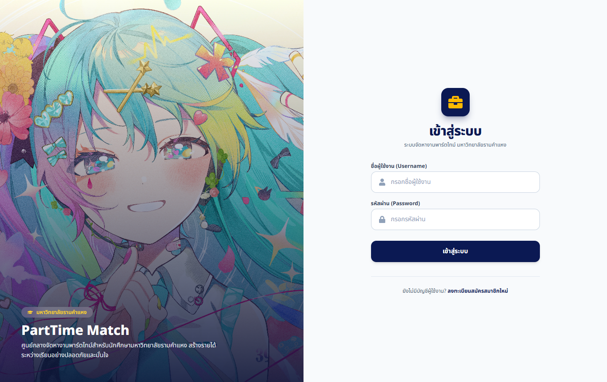

#### 1.2 หน้าสมัครสมาชิกนักศึกษา (Register Student)
- รองรับการกรอกรหัสนักศึกษา คณะ สาขาวิชา และชั้นปี เพื่อใช้จับคู่งาน
- ภาพหน้าจอ: `./screenshots/02_register_student.png`

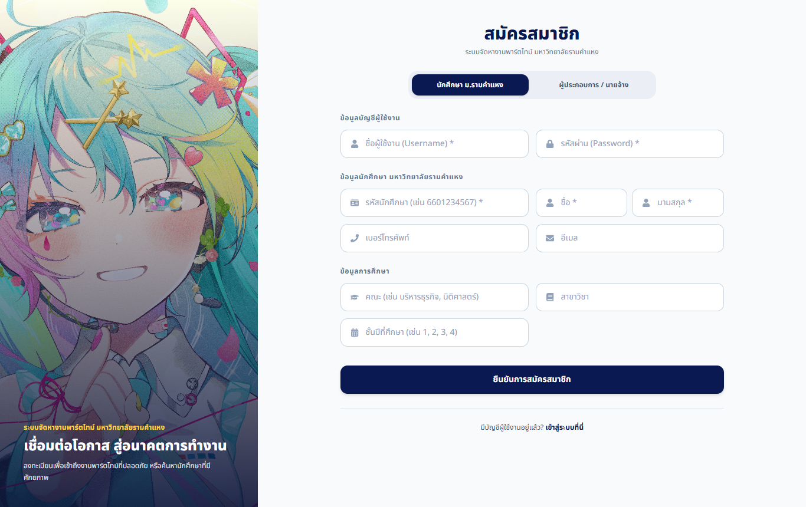

#### 1.3 หน้าสมัครสมาชิกผู้ประกอบการ (Register Employer)
- รองรับการบันทึกข้อมูลสถานประกอบการ ชื่อผู้ติดต่อ และพิกัดที่ตั้งรอบ ม.รามคำแหง
- ภาพหน้าจอ: `./screenshots/03_register_employer.png`

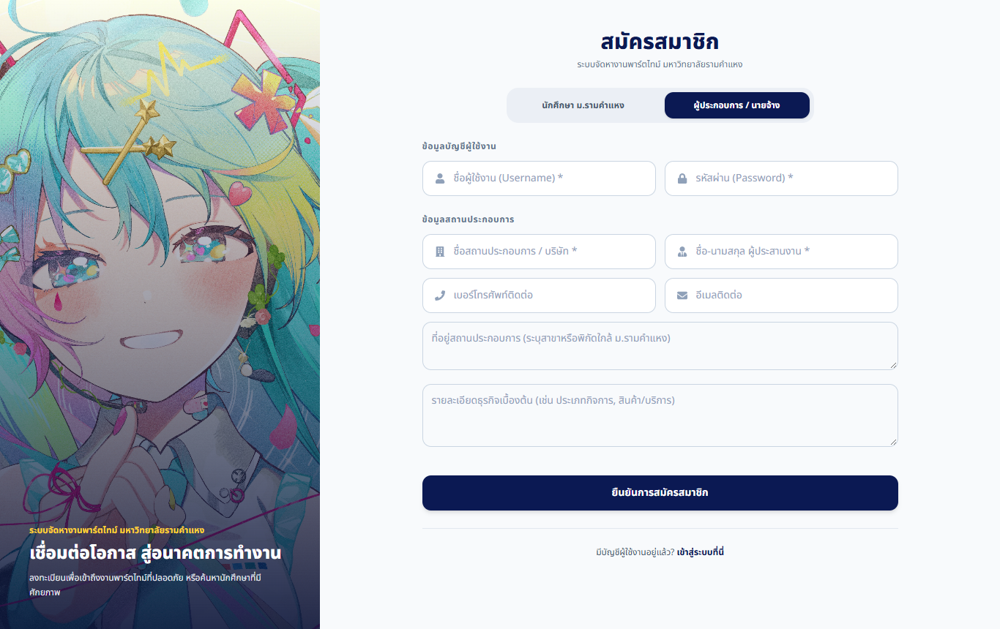

---

### 2. ระบบสำหรับนักศึกษา (Student Portal: FR-02 & FR-04)

#### 2.1 หน้าแดชบอร์ดนักศึกษา (Student Home)
- สรุปสถิติตำแหน่งงานที่เปิดรับ, งานที่สมัครแล้ว, ช่วงเวลาว่างที่ตั้งไว้, และเรื่องร้องเรียน
- แสดงคำแนะนำความปลอดภัยและมาตรการป้องกันการถูกหลอกลวงสำหรับนักศึกษา ม.ร.
- ภาพหน้าจอ: `./screenshots/04_student_home.png`

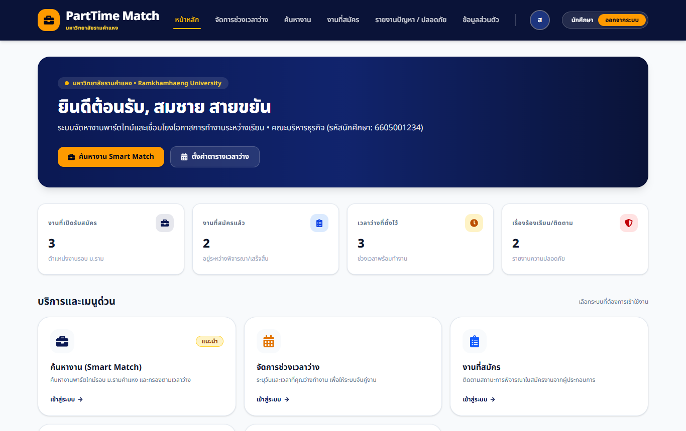

#### 2.2 ค้นหางานและตัวกรองพื้นที่รอบ ม.รามคำแหง (Job Search & Location Filter: FR-02)
- ค้นหาตามชื่องาน หมวดหมู่งาน
- กรองตามพื้นที่รอบมหาวิทยาลัย: ม.รามคำแหง 1 (หัวหมาก), ม.รามคำแหง 2 (บางนา), ลาดพร้าว, พระราม 9, ออนไลน์
- ภาพหน้าจอ: `./screenshots/05_student_jobs.png`

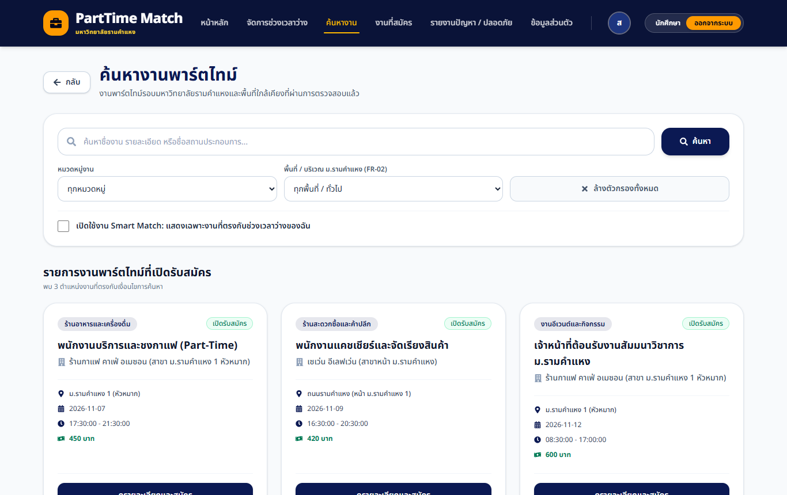

#### 2.3 ระบบ Smart Match ตามช่วงเวลาว่าง (NFR-01 & FR-02)
- ระบบกรองเฉพาะงานที่ตรงกับตารางเวลาว่างของนักศึกษาที่ลงทะเบียนไว้
- มีป้ายแจ้งสถานะ "Smart Match กำลังทำงาน" ชัดเจน
- ภาพหน้าจอ: `./screenshots/06_student_smart_match.png`

#### 2.4 รายละเอียดงานและปุ่มรายงานความไม่ปลอดภัย (Job Detail & Safety Action: FR-03, FR-04)
- แสดงข้อมูลสถานที่ วันที่ เวลา ค่าตอบแทน และคุณสมบัติ
- มีปุ่ม "รายงานปัญหาหรือเหตุการณ์ที่ไม่ปลอดภัยเกี่ยวกับงานนี้" เชื่อมโยงไปยังระบบร้องเรียนทันที
- ภาพหน้าจอ: `./screenshots/07_student_job_detail.png`

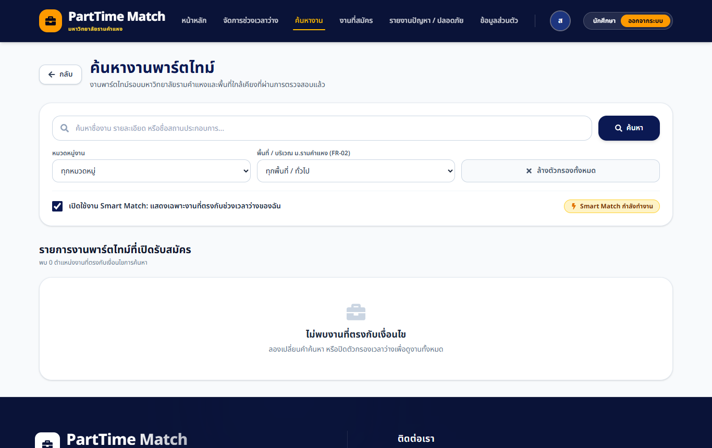

#### 2.5 จัดการช่วงเวลาว่าง (Student Availability: FR-02)
- กำหนดวันในสัปดาห์ เวลาเริ่มต้น และเวลาสิ้นสุดที่สะดวกทำงาน
- ภาพหน้าจอ: `./screenshots/08_student_availability.png`

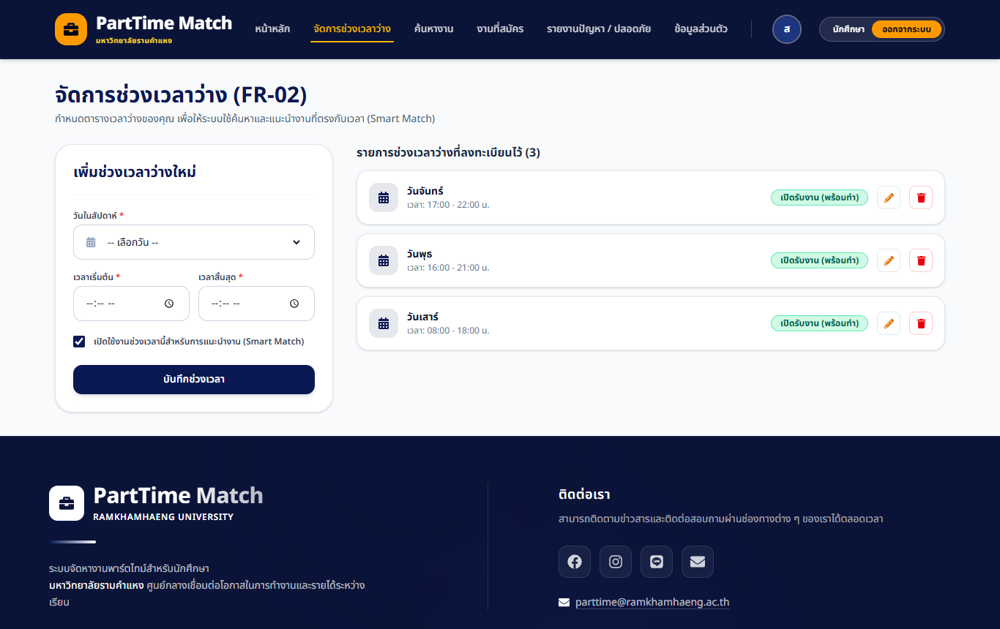

#### 2.6 ติดตามสถานะการสมัครงาน (Student Applications Tracker: FR-03)
- ติดตามสถานะใบสมัคร: รอพิจารณา (PENDING), ผ่านการคัดเลือก (ACCEPTED), ไม่ผ่าน (REJECTED)
- แสดงวันที่สมัคร วันที่พิจารณา และหมายเหตุตอบกลับจากผู้ประกอบการ
- ภาพหน้าจอ: `./screenshots/09_student_applications.png`

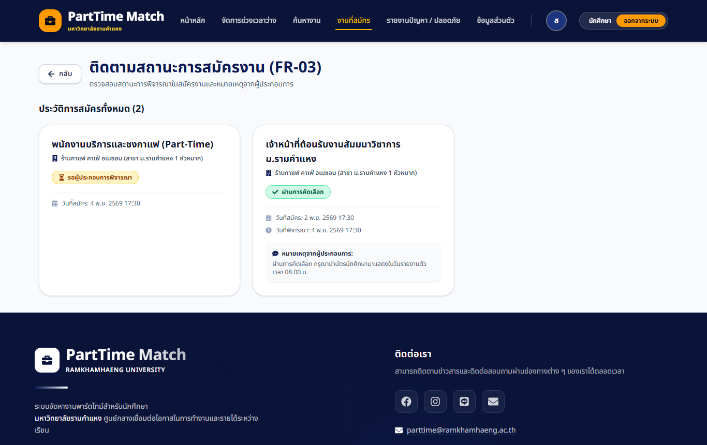

#### 2.7 รายงานปัญหาและแจ้งเหตุไม่ปลอดภัย (Safety & Complaint Reporting: FR-04)
- ส่งเรื่องร้องเรียนเลือกหมวดหมู่ปัญหา: ความปลอดภัยในสถานที่ทำงาน, ค่าจ้างไม่เป็นธรรม, งานไม่ตรงประกาศ, การคุกคาม
- อ้างอิงงานที่เกี่ยวข้อง และติดตามผลการตรวจสอบจากเจ้าหน้าที่มหาวิทยาลัย
- ภาพหน้าจอ: `./screenshots/10_student_complaints.png`

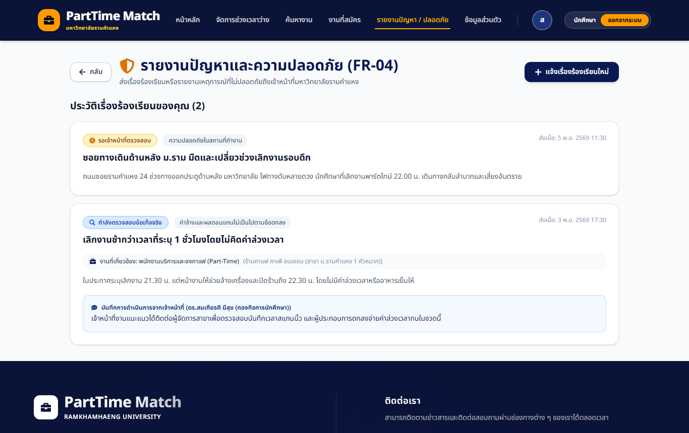

---

### 3. ระบบสำหรับผู้ประกอบการ (Employer Portal: FR-03 & FR-04)

#### 3.1 แดชบอร์ดผู้ประกอบการ (Employer Home)
- แสดงแบนเนอร์แจ้งสถานะการยืนยันตัวตน (`APPROVED` / `PENDING`)
- สรุปจำนวนประกาศงานทั้งหมด และงานที่กำลังเปิดรับสมัคร
- ภาพหน้าจอ: `./screenshots/11_employer_home.png`

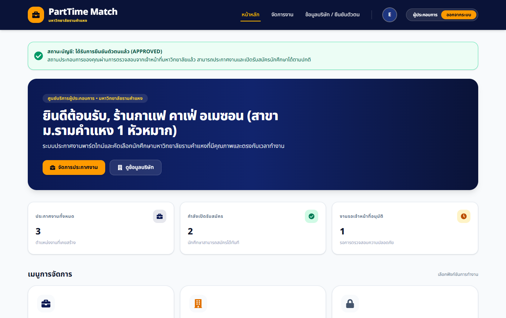

#### 3.2 จัดการประกาศงาน (Job Management: FR-03)
- บังคับตรวจการยืนยันตัวตนก่อนอนุญาตให้ประกาศงาน
- สร้าง แก้ไข เปิดรับสมัคร ปิดรับสมัคร และลบประกาศงาน
- ภาพหน้าจอ: `./screenshots/12_employer_jobs.png`

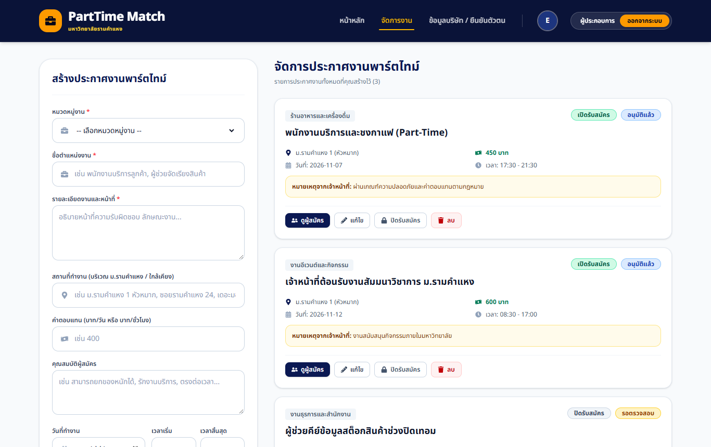

#### 3.3 ตรวจสอบและพิจารณาผู้สมัคร (Applicant Review: FR-03)
- ดูรายชื่อและโปรไฟล์นักศึกษา (คณะ, สาขา, ชั้นปี, เบอร์โทรศัพท์, อีเมล)
- บันทึกผลการพิจารณา รับเข้าทำงาน / ปฏิเสธ พร้อมหมายเหตุแจ้งนักศึกษา
- ภาพหน้าจอ: `./screenshots/13_employer_applications.png`

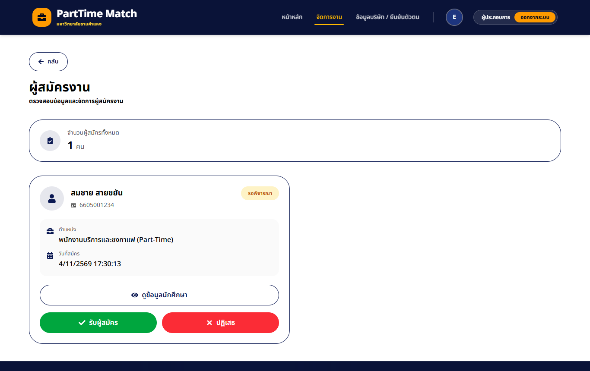

---

### 4. ระบบสำหรับเจ้าหน้าที่มหาวิทยาลัย (Officer Portal: FR-04)

#### 4.1 แดชบอร์ดเจ้าหน้าที่ (Officer Home)
- สรุปจำนวนผู้ประกอบการรออนุมัติ, งานรอตรวจสอบ, และเรื่องร้องเรียนใหม่ที่ต้องติดตาม
- ภาพหน้าจอ: `./screenshots/14_officer_home.png`

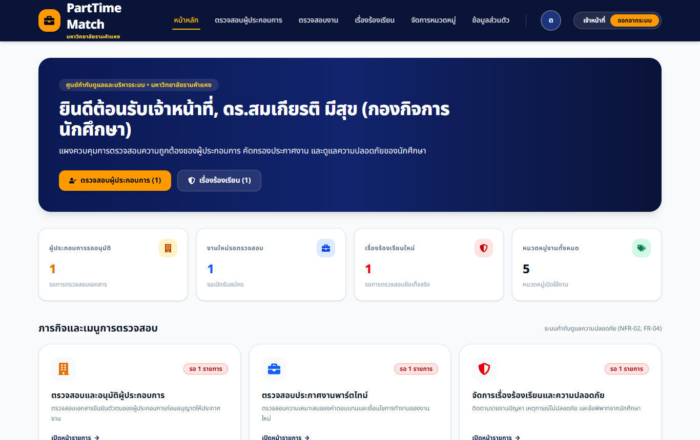

#### 4.2 ตรวจสอบและอนุมัติผู้ประกอบการ (Employer Verification: FR-03, FR-04)
- ตรวจสอบความถูกต้องของสถานประกอบการและเอกสาร ก่อนอนุญาตให้เผยแพร่งาน
- ภาพหน้าจอ: `./screenshots/15_officer_verify_employers.png`

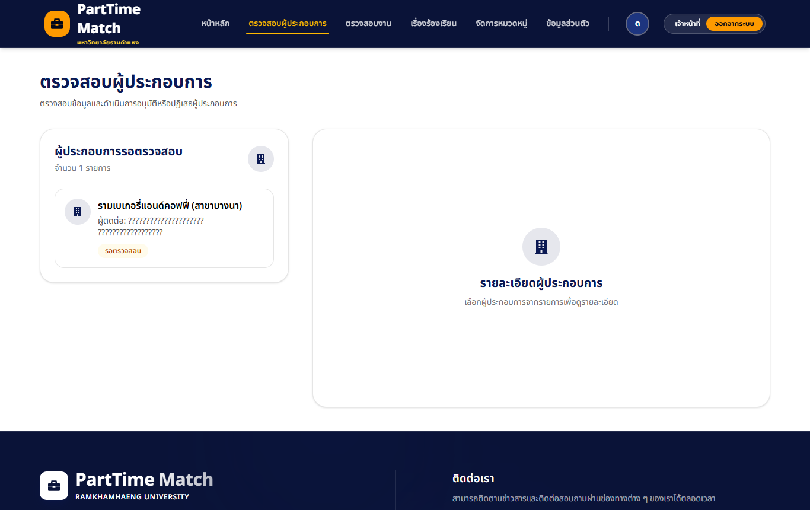

#### 4.3 ตรวจสอบประกาศงานพาร์ตไทม์ (Job Verification: FR-03, FR-04)
- ตรวจสอบอัตราค่าจ้างและเงื่อนไขการทำงาน เพื่อความปลอดภัยของนักศึกษา
- ภาพหน้าจอ: `./screenshots/16_officer_verify_jobs.png`

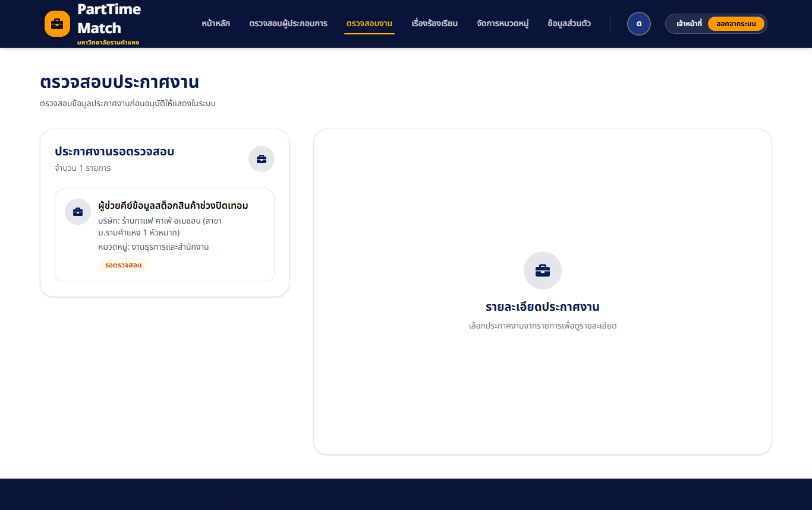

#### 4.4 จัดการและติดตามเรื่องร้องเรียนความปลอดภัย (Safety & Complaint Management: FR-04)
- กรองเรื่องร้องเรียนตามสถานะ: รอตรวจสอบ, กำลังตรวจสอบ, แก้ไขแล้ว, ยุติเรื่อง
- บันทึกความเห็น การประสานงาน และผลการคลี่คลายปัญหาเพื่อให้นักศึกษาตรวจสอบได้
- ภาพหน้าจอ: `./screenshots/17_officer_complaints.png`

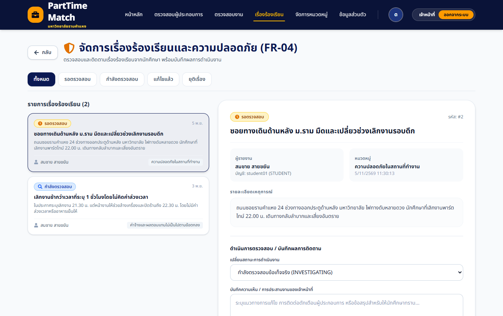

---

### สรุปผลการทดสอบ
- **Backend Build Test:** ผ่าน 100% (Maven compilation 0 errors)
- **Frontend Build Test:** ผ่าน 100% (Vite build 50 modules transformed 0 errors)
- **Functional Requirements:** ครบถ้วนตาม Fit Criteria ทุกข้อ (FR-01 ถึง FR-04)
- **Non-Functional Requirements:** Smart Match ทำงานรวดเร็ว, มีระบบรักษาความปลอดภัยและการยืนยันตัวตน, UI เป็นทางการ อ่านง่าย สวยงาม
